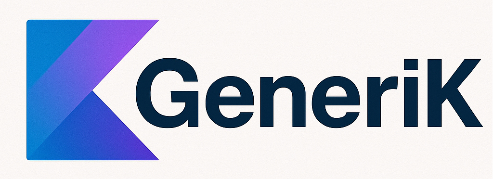

# Generik



Generik provides a powerful **GenericSerializer** class that eliminates the need for manual serialization and deserialization, helping developers write cleaner, more efficient code with less boilerplate.

## 🎯 Project Goals

Generik is both an educational playground and a powerful serialization toolkit built to:

- 🔍 **Showcase Generic Serialization**: Compare real-world strategies using Gson, Kotlinx Serialization, and custom solutions  
- 🧠 **Teach Through Practice**: Dive into complex data models with nested objects, collections, enums, and recursive types  
- ⚙️ **Harness Kotlin Reflection**: Experiment with reflection-based generic serializers — and understand their power and pitfalls  
- ⚖️ **Compare & Choose Wisely**: Gain insight into when to use Gson, Kotlinx, or roll your own with custom generics

## 🏗️ Project Structure

Generik is organized as a multi-module Kotlin project:

```
Generik/
├── lib/                           # 📚 Core GenericSerializer Library
│   ├── GenericSerializer.kt       # Reflection-based generic serializer
│   ├── extensions/                # Utility extensions
│   │   ├── GsonExtensions.kt      # Gson helper functions
│   │   └── KotlinxSerializer.kt   # Kotlinx serialization utilities
│   └── README.md                  # Library documentation
│
├── case-study/                    # 🔬 Serialization Performance Study
│   ├── shared-models/             # Common data models
│   │   ├── Address.kt, Company.kt, Person.kt
│   │   ├── Employee.kt, Enterprise.kt, Organization.kt
│   │   ├── Permission.kt, Project.kt, Role.kt
│   │   └── Team.kt, User.kt, Contact.kt
│   ├── scenario1_gson/            # Gson implementation
│   ├── scenario2_kotlinx/         # Kotlinx Serialization implementation
│   ├── scenario3_generik/         # GenericSerializer implementation
│   ├── benchmark/                 # Performance comparison tool
│   └── README.md                  # Case study documentation
│
├── serialization-demo/            # 🧪 Original Demo Collection
│   ├── GsonSerializationDemo.kt
│   ├── KotlinSerializationDemo.kt
│   ├── ComplexGsonDemo.kt
│   ├── ComplexKotlinxDemo.kt
│   ├── AdvancedComplexGsonDemo.kt
│   ├── AdvancedComplexKotlinxDemo.kt
│   └── test/                      # Comprehensive test suite
└── art/banner.jpg                 # Project banner

### Prerequisites
- Java 21+ (configured with JVM Toolchain)
- Gradle 8.9 (handled by wrapper)

### 🧪 Test Coverage Summary

| Demo Class | Object Type | Serializer | Status | Test Coverage |
|------------|-------------|------------|---------|---------------|
| GsonSerializationDemo | Organization | Gson | ✅ Full | ✅ Complete |
| KotlinSerializationDemo | User | Built-in @Serializable | ✅ Full | ✅ Complete |
| ComplexGsonDemo | Organization | Gson | ✅ Full | ✅ Complete |
| ComplexKotlinxDemo | Organization | GenericSerializer | ⚠️ Limited | ✅ Error Handling |
| AdvancedComplexGsonDemo | Enterprise | Gson | ✅ Full | ✅ Complete |
| AdvancedComplexKotlinxDemo | Enterprise | GenericSerializer | ⚠️ Limited | ✅ Error Handling |

## 📚 Module Details

### lib/ - Core Library
- `GenericSerializer.kt`: Reflection-based serializer for any Kotlin data class
- `extensions/GsonExtensions.kt`: Convenient Gson extension functions
- `extensions/KotlinxSerializer.kt`: Kotlinx serialization utilities

### case-study/ - Performance Analysis
- **shared-models/**: Rich data models used across all scenarios
- **scenario1_gson/**: Traditional Gson approach with plain data classes
- **scenario2_kotlinx/**: Modern Kotlinx Serialization with @Serializable annotations
- **scenario3_generik/**: GenericSerializer approach showcasing reflection capabilities and limitations
- **benchmark/**: Performance testing framework comparing all approaches

### serialization-demo/ - Educational Examples
- Original demo classes showing basic to advanced serialization patterns
- Comprehensive test suite demonstrating expected behaviors and edge cases
- Progressive complexity from simple User objects to complex Enterprise structures

## 🚀 Future Improvements

The project demonstrates both the power and limitations of different serialization approaches:

**GenericSerializer Enhancements:**
- **Enhanced Reflection Access**: Investigate workarounds for Java module system restrictions
- **Performance Optimization**: Implement caching and optimize reflection usage
- **Error Recovery**: Add fallback mechanisms for complex nested structures

**Project Extensions:**
- **Additional Serializers**: Support for other popular libraries (Jackson, Moshi)
- **Code Generation**: Explore annotation processing alternatives
- **Microservices Integration**: Demonstrate serialization in distributed systems 

These improvements would make the GenericSerializer more robust while maintaining its educational value in demonstrating the challenges and solutions in generic serialization.

## 📄 License

MIT License

Copyright (c) 2025 Fernando Prieto Moyano

This project is licensed under the MIT License - see the [LICENSE](LICENSE) file for details.

The MIT License is a permissive license that allows for commercial use, modification, distribution, and private use. This project is open-source and welcomes contributions from the community.
